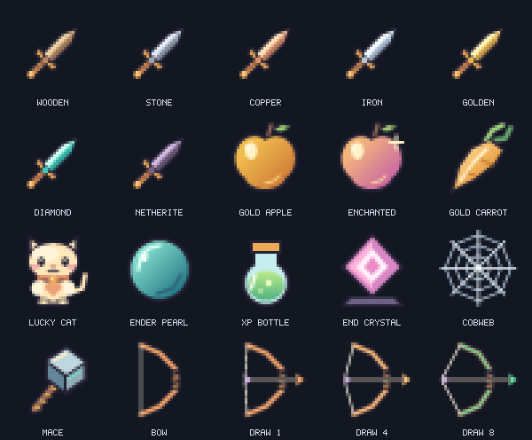

🔥 PVPSE Client
PVPSE Client is a next-generation Minecraft Fabric client focused on performance, customization, and a premium PvP experience. Built with a modern design philosophy, PVPSE combines a powerful HUD system, smooth animations, and a sleek interface inspired by the best Minecraft clients while keeping its own unique identity.
Featuring a fully customizable HUD, advanced ClickGUI, dynamic themes, and optimized rendering systems, PVPSE gives players complete control over their Minecraft experience.
Features:
⚡ Modern ClickGUI
A clean, animated interface with custom themes, smooth transitions, and easy module management.
🎨 Custom HUD System
Move, resize, and customize your HUD elements including FPS, CPS, Armor, Coordinates, Keystrokes, and more.
🔥 PVPSE Ignite Theme
A unique dark interface with orange/fire accents, glowing effects, and a premium client aesthetic.
🚀 Performance Focused
Optimized rendering, lightweight systems, and smooth animations designed for high FPS gameplay.
⚙️ Advanced Customization
Save configurations, change colors, edit layouts, and create your own personal setup.
✨ Professional Experience
Designed for players who want a clean, powerful, and customizable Minecraft client.
PVPSE Client — Your Minecraft. Your Style. Your Control. 🔥

## Installation (v2.6.0)

Requires Minecraft **26.1.2**, Fabric Loader **0.19.3+**, Fabric API **0.155.2+26.1.2 or newer for 26.1.2** and Java **25**. Place PVPSE-2.6.0.jar in your Minecraft mods folder alongside Fabric API.

## Controls and settings

- Right Shift: open the client interface
- H: toggle the HUD
- Z: hold to zoom; B: add waypoint; V: toggle Fullbright
- Left-click a module to toggle it; right-click to expand settings
- HUD modules: scale, X/Y position and reset layout
- HUD EDITOR: drag widgets to arrange your layout
- Search filters modules; mouse wheel scrolls the module list
- Changes save when leaving the main interface and periodically during play
- Profiles live in config/pvpse/profiles/default.json; controls can be rebound in Minecraft settings

## Waypoints and radar (1.7.0)

Open WAYPOINTS from the Right Shift menu. ADD HERE saves your position; select a row to rename, delete, TRACK, change its COLOR, SHOW/HIDE it or COPY XYZ. Clearing all points asks for confirmation.

RANGE cycles 32/64/128/256/512 blocks from the radar center to its edge. NORTH UP/ROTATING changes orientation. LABELS controls on-screen destination labels separately from radar dots. DEATH saves a marker once when you die. Tracked destinations render first; otherwise the nearest visible point is used. Labels show horizontal distance and vertical offset.

New waypoints are isolated by server/world and dimension. Older waypoints stay accessible and display "legacy". The minimap is a waypoint radar with grid and heading, without terrain or entity scanning. Right-click Waypoint in the module list for position, scale and reset controls.

## General settings (2.1.0)

Open Right Shift > SETTINGS & PROFILES for global switches, profile switching, copying your current HUD/theme to a new profile, and resetting HUD positions/scales. Profiles do not include global feedback, waypoint or custom crosshair files. Your active profile is remembered; the former default.json migrates automatically to the profiles folder.

Drag module sliders to adjust them. In HUD EDITOR, select a widget and use arrow keys to move it one pixel, or Shift+arrow for ten. R resets its layout; Ctrl+Z restores positions, scales and visibility from the start of the editor session. Utilities stay in the module list rather than appearing as editor widgets.

During keybind capture, Escape cancels and Backspace/Delete unbinds. Bindings save when Minecraft closes normally. F1 hides overlays; "Hide on F3" controls debug-screen visibility. "No damage tilt" is now optional.

## Ownership and permissions

Copyright (c) 2026 superielYT. All rights reserved for owner-controlled material
covered by [LICENSE](LICENSE). Reuse, redistribution, and building derivative
projects require prior written permission from superielYT, subject to the
exceptions in that notice.

ChatGPT/Codex and GitHub Copilot may assist only on superielYT's instructions
for this project; this is not permission for others to reuse the project.

Previously granted MIT rights and third-party licenses remain unaffected.
A public GitHub repository can still be viewed and forked under GitHub's
terms. A copyright notice does not technically prevent copying.

## Cleaner customization and PvP visibility (2.1.0)

The Right Shift menu now has a navigation sidebar, search and ALL / HUD /
TOOLS / ON module filters. Use the + control or right-click for module settings.

Settings are split into General, Combat, Effects and Profiles:
- Attack cooldown bar: appears beneath the crosshair only while recharging.
- Low-health alert: choose 2–16 HP (2 HP = one heart); absorption is not counted.
- Armor alert: choose 5–50% remaining durability; checks equipped, damageable armor.
- Hit marker size: 3–10 pixels; damage-flash opacity: 10–100%; particles: 4–48.
- Minimal Effects disables the damage flash and kill particles.
- Click numeric values to increase them; after the maximum they wrap to the minimum.
- Alerts and effects are global; profiles retain their existing HUD/theme scope.
- Combat indicators hide in menus, spectator mode, F1 and (if enabled) F3.

## PVPSE Ignite resource packs

Choose one edition for **Minecraft Java 26.1.2**:
- [Ignite 32x Smooth](https://github.com/superielYT/PVPSE/releases/download/v2.5.0/PVPSE-Ignite-32x-26.1.2.zip): richer shading, highlights and resolved edges.
- [Ignite 16x Lite](https://github.com/superielYT/PVPSE/releases/download/v2.5.0/PVPSE-Ignite-16x-26.1.2.zip): the same original art with smaller textures.

Enable ONE edition above other packs. Both include short swords, a lucky-cat totem,
glossy golden foods, pearl, XP bottle, crystal, mace, open cobweb and low shields.
Bows use eight draw stages; green appears at the full 20-tick draw. Attack timing,
reach and damage remain vanilla. Vanilla shield banners are preserved.

Regenerate both editions with Node 22: `node tools/build-pvp-pack.mjs`.
Generation validates every PNG CRC and decoded size, JSON, model entries and ZIP determinism.
Actions checks ZIP integrity with Python, compiles the mod, runs regression and geometry
checks, then starts a real Minecraft client in a virtual display to catch startup crashes.
That smoke test does not simulate gameplay or validate all server/mod combinations.

## Bow charge textures and melee hitbox display

Ignite now includes idle and eight bow pulling sprites: progressively brighter gold during the
draw, then green at the full 20-tick draw. Resource-pack
item selection changes only the visual state; firing behavior stays vanilla.

Open SETTINGS & PROFILES > HITBOX:
- Enable Melee hitboxes, then allow swords and/or mace in the main hand.
- Target only is on by default. Turn it off to show up to 16 nearest visible,
  living entities inside the module's View range.
- Toggle eye-level rings, state colors and line widths from 1–4.
- Selected target: green when the attack cooldown is ready, amber while it
  recovers, purple while falling more than 1.5 blocks with a ready mace.
  Purple shows the local falling state, not a guaranteed smash or hit.
- Boxes follow interpolated entity movement and preserve real bounding dimensions.
- Display range is measured from your eyes to the nearest point on each box.
- Hidden in menus, spectator mode, F1, disabled HUD and optionally F3.
- Weapon/display preferences are global; module enabled state and range are
  saved with HUD profiles. This is a visual overlay and changes no reach or collision.

## Bug fixes (2.1)

- Brightness now uses Minecraft's valid 0–100% gamma range and restores your original value when disabled. The feature ID/keybind is kept for existing profiles.
- Global settings, custom crosshair and theme saves use atomic replacement; malformed settings are backed up before recovery.
- Invalid crosshair imports cannot partly mutate the current crosshair; imported colors remain visible.
- Removed duplicate legacy low-health notifications that ignored the alert switch.
- Feedback resets when the player changes; death particles watch briefly after the confirmed hit instead of checking death only on the hit tick. Confirmation is a client estimate, not authoritative kill credit.
- Reach updates on confirmed hurt feedback; combos reset when changing targets.
- Invalid or incomplete profiles restore defaults rather than inheriting the previous layout/theme.
- Numeric crosshair/opacity settings are clamped; panel opacity now maps percentages to full 0–255 alpha.
- Partially hidden module controls cannot receive clicks; potion rows fit the visible card and handle infinite effects.

## HUD style (2.2)

Right Shift > Settings & profiles > STYLE adds Clear Glass as an optional theme.
All previous palettes remain available with refined panel surfaces.
Choose HUD opacity, accent lines, panel shadows and text shadow. MINIMAL HUD applies
a restrained preset; RESET STYLE restores appearance defaults. These preferences
are saved and copied with each HUD profile. Menu backgrounds remain independent
of the HUD opacity control for readability.

## Cannot see the GUI or HUD? (2.3)

The client JAR belongs in **mods**, with Fabric API. The Ignite ZIP belongs in
**resourcepacks** and changes textures only: it cannot install the client GUI/HUD.
Restart Minecraft after replacing the old PVPSE JAR (keep only one version).

Look for **PVPSE** in the upper-left of the title or pause menu. In a world,
**Right Shift**, **F8**, or **/pvpse** opens the menu. **HUD: ON/OFF** controls
visibility. **RESTORE HUD** (or **/pvpse restore**) enables and repositions the
current profile's HUD and clears F1/debug hiding. The other profiles and selected
theme remain unchanged. HUD editing requires joining a world.

2.3 includes new short swords, wind-core mace, cute apples and moon pearl,
while preserving the lucky-cat totem. Buttons now follow your selected theme.

## Ignite Final (2.5.0)

Block Overlay shows the block under your crosshair with its name, icon, ID, position and distance. A theme-colored outline follows the selected shape. F8 > Settings & profiles > General > Block Overlay toggles it. In HUD editor, drag it to move; use its corner, mouse wheel or +/- to resize. It hides when no block is targeted and saves with your profile.

Dark inventory, chest, crafting, hotbar and button textures. Includes 55 cleaner blocks and unique book covers for all 43 vanilla enchantments at every level. Combined books use the first matching enchantment listed in BOOKS.txt; tooltips remain unchanged. No renaming, CIT or OptiFine required. Activate one Ignite ZIP above other packs.

## HUD visibility and full-screen placement (2.5.1)

HUD editor: drag cards to any screen edge. The toolbar is at the top; Tab hides or shows it. Click a card's X, use Hide, Delete or right-click to remove it. HUDs > Hidden lets you bring cards back with their existing position and size. Disabled cards stay hidden in the editor and gameplay. Changes save with your profile. Restore HUD preserves your visibility choices.

## Optional HUD cards and quicker selection (2.6.0)

F8 > HUD editor > HUDs now has a search box, All/Shown/Hidden filters and an enabled-card count. Held Items shows main/offhand stacks and durability. Resource Packs lists active user file packs in priority order. Both new cards start OFF, including on existing profiles; enable them when wanted. Their first activation searches for free space. Auto arrange only moves shown cards, keeping hidden cards' layouts intact.
